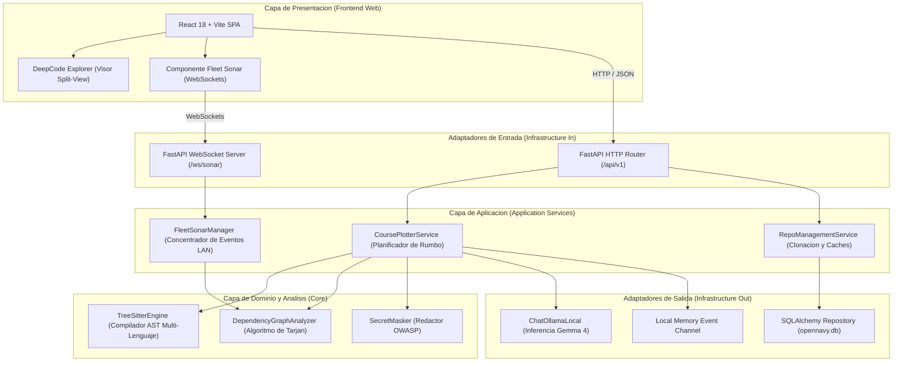

# Arquitectura de Software de OpenNavy

## 1. Vision General y Principios de Diseno

OpenNavy está diseñado siguiendo los principios de la Arquitectura Hexagonal (Puertos y Adaptadores) y Clean Architecture, priorizando la soberanía de datos, el aislamiento determinista y la mantenibilidad por parte de la comunidad de código abierto.

### Principios Fundamentales:
1. **Soberania Local-First:** El sistema debe operar en su totalidad sin conexión a internet externa. La inferencia de lenguaje, el análisis sintáctico y la coordinación multijugador ocurren dentro del perímetro de la máquina o de la red de área local (LAN).
2. **Determinismo Estructural sobre Alucinacion de IA:** La búsqueda de funciones, clases y grafos de dependencias la resuelven algoritmos deterministas (Tree-sitter y Algoritmo de Tarjan). La IA generativa (Google Gemma 4) se utiliza exclusivamente como capa de síntesis, razonamiento y planificación.
3. **Bajo Acoplamiento y Alta Cohesion:** La lógica de análisis de código no conoce frameworks web ni librerías de inferencia. Cualquier componente de infraestructura puede sustituirse sin alterar el dominio.

---

## 2. Diagrama Estructural por Capas



---

## 3. Descripcion Detallada de las Capas

### A. Capa de Dominio (Core Analysis Engine)
Reside en `backend/app/analyzers/` y no tiene dependencias de librerías web ni bases de datos:
* **`treesitter_engine.py`:** Utiliza gramáticas nativas compiladas de Tree-sitter para generar representaciones abstractas de sintaxis en Python, TypeScript, JavaScript, Go y Java. Extrae firmas de métodos, llamadas y directivas de importación sin distorsión por comentarios o literales de cadena.
* **`dependency_graph.py`:** Construye el grafo dirigido de importaciones y llamadas entre módulos. Implementa el algoritmo de Tarjan para identificar Componentes Fuertemente Conexos (SCC) en tiempo lineal O(V + E), detectando ciclos arquitectónicos (Arrecifes de Código).
* **`secret_masker.py`:** Escanea y redacta tokens de acceso personal, claves privadas y secretos antes de que cualquier fragmento de código sea procesado por el modelo de lenguaje.

### B. Capa de Aplicacion (Application Services)
Orquesta el flujo de negocio y la coordinación de casos de uso:
* **`CoursePlotterService` (`backend/app/api/v1/endpoints/course.py`):** 
  1. Recibe la misión técnica (issue o captura de pantalla).
  2. Invoca a Tree-sitter para correlacionar símbolos candidatos.
  3. Ejecuta el análisis de Tarjan para calcular el radio de impacto (*blast radius*).
  4. Formula el prompt estructurado para Google Gemma 4 solicitando salida JSON estricta.
  5. Notifica al Sonar de Flota el nuevo plan de navegación trazado.
* **`FleetSonarManager` (`backend/app/api/v1/endpoints/sonar.py`):**
  1. Mantiene el registro en memoria de tripulantes activos en la red local.
  2. Procesa eventos de navegación (`NAVIGATE`).
  3. Consulta la matriz topológica para evaluar si dos desarrolladores están inspeccionando módulos acoplados.
  4. Emite difusiones inmediatas de `COLLISION_ALERT` si se detecta proximidad de conflicto.

### C. Capa de Infraestructura (Infrastructure Adapters)
Implementa los puertos definidos por la aplicación:
* **Inferencia Local (`ChatOllamaLocal` en `backend/app/core/ollama_client.py`):**
  Mantiene la comunicación HTTP de baja latencia con el demonio local de Ollama en `localhost:11434`, enviando parámetros de temperatura baja (0.1) y manteniendo el modelo cargado en memoria (`keep_alive=-1`).
* **Persistencia (`backend/app/core/database.py` y `backend/app/models/`):**
  Almacena metadatos de repositorios, sesiones de exploración y configuraciones en `opennavy.db` utilizando SQLAlchemy ORM.

### D. Capa de Presentacion (Web Cockpit)
Reside en `frontend/` y está construida con React 18, Vite y TypeScript:
* **`NauticalChart` / `ArchitectureView.tsx`:** Renderiza visualmente el grafo de dependencias y los arrecifes topológicos.
* **`CoursePlotter` (`CoursePlotterPanel.tsx` / `UnifiedWorkspaceView.tsx`):** Permite ingresar issues de texto o arrastrar capturas de error visuales (multimodal Base64 con Gemma 4), presentando los waypoints resultantes con enlaces interactivos que manipulan el visor de código AST split-view.
* **`FleetSonarBanner`:** Muestra la presencia en tiempo real de los compañeros en la misma red LAN y despliega alertas visuales de colisión arquitectónica.

---

## 4. Estructura del Arbol de Directorios del Proyecto

```
OpenNavy/
|-- BACKLOG.md                  # Backlog oficial del producto e historias de usuario
|-- LICENSE                     # Licencia MIT permisiva
|-- .gitignore                  # Exclusion de artefactos pesados y binarios
|-- docs/
|   |-- ARCHITECTURE.md         # Especificacion maestra de arquitectura de software
|   |-- OPENNAVY_SPECIFICATION.md # Documento de producto y negocio
|   `-- adr/                    # Architecture Decision Records (MADR)
|       |-- 0001-record-architecture-decisions.md
|       |-- 0002-modular-hexagonal-architecture.md
|       |-- 0003-local-first-inference-with-gemma4.md
|       |-- 0004-lan-multiplayer-mesh-with-fastapi-websockets.md
|       `-- 0005-gitflow-and-conventional-commits.md
|-- backend/                    # Nucleo de analisis, API y orquestacion
|   |-- requirements.txt        # Dependencias Python
|   |-- Dockerfile              # Contenedor de ejecucion independiente
|   `-- app/
|       |-- analyzers/          # Motores deterministas: Tree-sitter y Tarjan
|       |-- api/                # Enrutadores REST y WebSockets (v1)
|       |-- core/               # Configuracion y adaptadores de inferencia
|       |-- models/             # Entidades de base de datos
|       |-- schemas/            # Contratos de datos tipados (Pydantic)
|       `-- main.py             # Punto de entrada de la aplicacion FastAPI
|-- frontend/                   # Interfaz de usuario (React 18 + Vite)
|   |-- package.json
|   |-- vite.config.ts
|   `-- src/                    # Componentes de la cabina de mando y visor split-view
`-- scripts/                    # Utilidades de arranque local y diagnostico
    |-- start-server.ps1        # Script de 1 clic para host local y tunel
    `-- test-inference.py       # Prueba de latencia y streaming de Gemma 4
```

---

## 5. Directrices de Contribucion para Desarrolladores Open Source

1. **Aislamiento de Analizadores:** Todo nuevo analizador sintáctico para un lenguaje adicional debe ubicarse dentro de `backend/app/analyzers/` y satisfacer la interfaz de extracción de AST sin acoplarse a capas web.
2. **Contratos Tipados:** Ninguna entidad debe viajar entre el backend y el frontend sin un esquema Pydantic en Python y su correspondiente interfaz TypeScript en `frontend/src/services/api.ts`.
3. **Flujo de Trabajo:** Todo desarrollo debe originarse desde la rama `develop` mediante ramas de características `feature/<nombre>` y comitearse bajo el formato de Commits Convencionales sin emojis.
