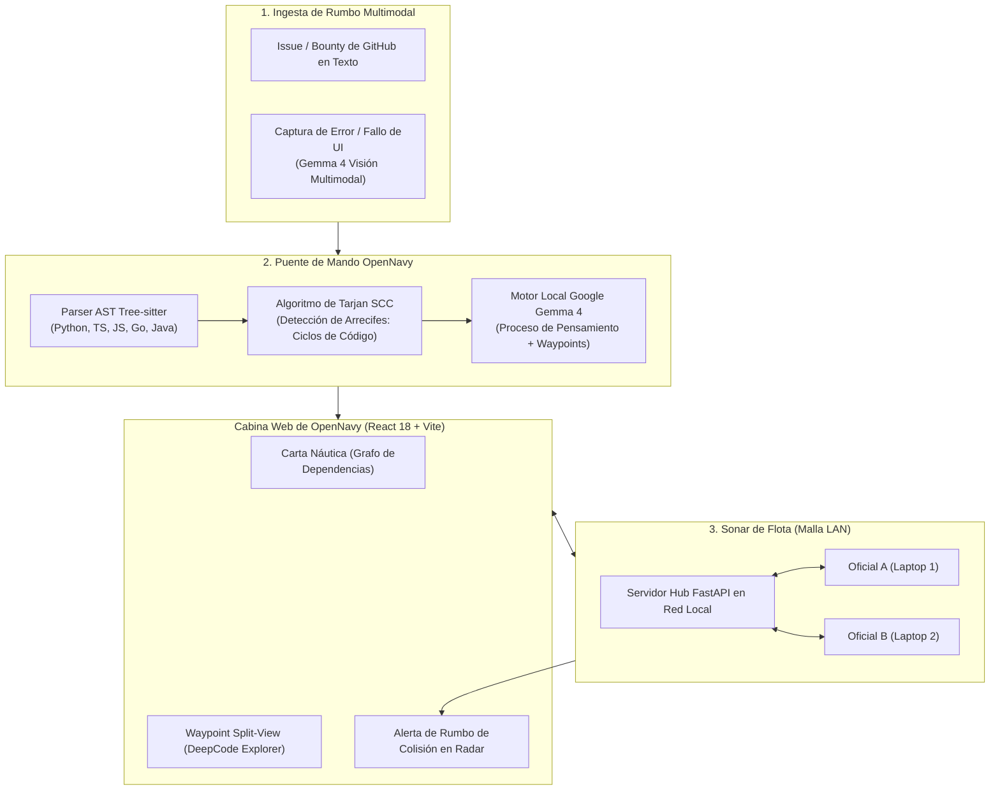

# OPENNAVY: El Navegador Soberano de Flota para Repositorios Open Source
### Especificación Oficial de Producto, Arquitectura y Modelo de Negocio
**Competición:** Major League Hacking (MLH) — Hacktoberfest 2026  
**Categorías Objetivo:**  
1.  **Mejor Proyecto de IA Open Source** *(DigitalOcean / Hacktoberfest 2026)*  
2.  **Mejor Uso de Gemma 4** *(Google DeepMind)*  
**Licencia:** Licencia MIT (100% Código Abierto Permisivo)

---

## 1. Resumen Ejecutivo e Identidad de Marca

**OpenNavy** es una cabina de mando soberana y un radar arquitectónico multijugador local-first diseñado para resolver dos de las crisis más profundas en la ingeniería de software moderna:

1. **La Deserción de Contribuidores en el Open Source:** El 80% de los desarrolladores abandonan los repositorios de código abierto durante sus primeros intentos porque descifrar una base de código desconocida de 50.000 líneas toma días.
2. **El Muro de Cumplimiento de la IA en la Nube:** Equipos en industrias reguladas (banca, salud, defensa, gobierno) tienen terminantemente prohibido utilizar asistentes en la nube (Claude Code, Cursor, GitHub Copilot) porque enviar código propietario fuera de su red privada viola normativas de seguridad (SOC2, GDPR, ISO 27001).

OpenNavy derriba esta barrera transformando la exploración de código y la resolución de incidencias en una **carta náutica interactiva y multijugador impulsada por Google DeepMind Gemma 4 ejecutándose 100% en local sobre hardware estándar**, comunicada entre terminales de desarrolladores a través de una red local (LAN) mediante WebSockets sin tocar internet.

```
       __...--~~~~~-._   _.-~~~~~--...__
     //               `V'               \\ 
    //                 |                 \\
   //__...--~~~~~~-._  |  _.-~~~~~~--...__\\
  //__.....----~~~~._\ | /_.~~~~----.....__\\
 ===================\\\|///===================
                     `---'
      O P E N N A V Y  ·  F L E E T  O S
```

### El Universo Metafórico Náutico
* **La Base de Código:** *El Archipiélago Inexplorado* (El océano de carpetas, módulos y lógica heredada).
* **Navegador de Código:** *La Carta Náutica* (Mapa topológico interactivo de dependencias generado con Tree-sitter y el Algoritmo de Tarjan).
* **Solucionador de Issues (IssueCraft):** *El Trazador de Rumbo (Course Plotter)* (Ingesta multimodal de issues que calcula los waypoints y listas de verificación exactas).
* **Multijugador LAN:** *El Sonar de Flota (Fleet Sonar)* (Presencia en vivo de los compañeros y radar de colisión arquitectónica).
* **Motor de IA:** *El Almirante (The Admiralty AI)* (Google Gemma 4 razonando de forma soberana con cero telemetría).

---

## 2. Alineación Estratégica con los Tracks de la Hackathon

### A. Track 1: Mejor Proyecto de IA Open Source (DigitalOcean / Hacktoberfest 2026)
* **Diseñado Específicamente para Hacktoberfest:** OpenNavy permite a cualquier colaborador completar sus Pull Requests de Hacktoberfest sin la fatiga del onboarding en repositorios complejos.
* **100% Open Source con Licencia MIT:** Máxima transparencia, auto-hospedable, sin dependencia de proveedores propietarios (*vendor lock-in*).
* **Harness de IA de Pesos Abiertos:** Integra modelos ligeros abiertos (`gemma4:e4b` / `gemma4:e2b`) con analizadores sintácticos deterministas (Tree-sitter) y grafos topológicos (Tarjan).

### B. Track 2: Mejor Uso de Gemma 4 (Google DeepMind)
* **Experiencia Multimodal:** Los contribuidores pueden pegar texto de un issue O arrastrar capturas de pantalla de fallos de interfaz (UI bugs), diagramas de error o trazas de la terminal. **Gemma 4 Visión** analiza el artefacto visual, lo correlaciona con el AST local del código y marca las coordenadas exactas en los archivos fuente.
* **Razonamiento Nativo (`<|think|>`):** Expone el proceso de pensamiento interno de Gemma 4 en la interfaz como el *"Flujo de Razonamiento del Almirante"*, demostrando cómo el modelo dedujo las dependencias antes de emitir el plan.
* **Eficiencia y Prototipado Rápido:** Ejecución cuantizada (Q4_K_M) corriendo a 10-45 tokens/segundo en laptops convencionales sin costos de suscripción ni límites de cuota.

---

## ️ 3. La Trilogía de la Flota: Módulos Funcionales Centrales



---

### Módulo 1: La Carta Náutica (Code Navigator)
* **Objetivo:** Reemplazar documentación muerta y READMEs desactualizados por una topología arquitectónica interactiva en tiempo real.
* **Mecanismo Técnico:**
  1. Tree-sitter compila el árbol sintáctico abstracto (AST) del repositorio en múltiples lenguajes (Python, TypeScript, JavaScript, Go, Java).
  2. El **Algoritmo de Tarjan** evalúa la matriz de importaciones y llamadas, detectando Componentes Fuertemente Conexos (SCC).
  3. Los ciclos y módulos altamente acoplados se señalan visualmente como **"Arrecifes Peligrosos"**, advirtiendo a los colaboradores dónde no modificar código sin precauciones especiales.

---

### Módulo 2: El Trazador de Rumbo (IssueCraft + Gemma 4 Multimodal)
* **Objetivo:** Eliminar la distancia entre un reporte de incidencia y la primera línea de código editada.
* **Mecanismo Técnico:**
  1. El usuario pega el enlace de un issue o arrastra una imagen de un error visual o excepción de terminal.
  2. **Google Gemma 4** procesa el contexto textual y visual, consulta el índice del repositorio y genera el **Plan de Vuelo Náutico**:
     - **Waypoints (Coordenadas Exactas):** Enlaces clicables con rangos de línea (ej. `[src/auth/jwt.py:42-65]`). Al hacer clic, el panel lateral abre el archivo y se desplaza automáticamente a la sección correspondiente.
     - **Alerta de Radio de Impacto (*Blast Radius*):** Notifica qué módulos o servicios colaterales podrían verse afectados por el cambio.
     - **Lista de Verificación Paso a Paso:** 3 a 4 instrucciones técnicas directas para implementar la solución.
     - **Generador de Pull Request & Conventional Commit:** Redacta el mensaje estandarizado (`feat(...)`, `fix(...)`) y la plantilla completa del PR en Markdown.

---

### Módulo 3: El Sonar de Flota (Radar Multijugador LAN)
* **Objetivo:** Erradicar las colisiones de código y los conflictos de integración (*merge conflicts*) en hackathons, sprints o redes corporativas aisladas.
* **Mecanismo Técnico:**
  1. La máquina central hospeda un concentrador de WebSockets ligero sobre FastAPI (`/ws/sonar`).
  2. Todos los integrantes del equipo en la misma red Wi-Fi o punto de acceso se conectan instantáneamente sin necesidad de crear cuentas.
  3. **Presencia en Vivo de la Tripulación:** El árbol de archivos muestra insignias en tiempo real indicando qué archivos está explorando cada compañero.
  4. **Alerta de Rumbo de Colisión (*Collision Course Alert*):**
     Si el Desarrollador A investiga `auth_service.py` mientras el Desarrollador B abre `session_store.py` (los cuales dependen mutuamente según el grafo de Tarjan), ambas pantallas activan una advertencia visual inmediata:
     > ️ **RUMBO DE COLISIÓN DETECTADO**  
     > *El Oficial Daniel y el Oficial Carlos están modificando módulos con fuerte acoplamiento (`auth_service` ↔ `session_store`). Coordinen cambios antes de hacer commit.*

---

## 4. Modelo de Negocio y Viabilidad Comercial

OpenNavy adopta una estrategia comercial **Open-Core**:

| Nivel | Público Objetivo | Despliegue | Precio | Capacidades Clave |
| :--- | :--- | :--- | :--- | :--- |
| **Edición Comunitaria (Open Source)** | Mantenedores de software libre, participantes de Hacktoberfest, devs independientes | Localhost / Docker auto-alojado | **$0 (Licencia MIT)** | Inferencia local completa con Gemma 4, Carta Náutica, Trazador de Rumbo y Sonar de Flota en red local. |
| **Flota Enterprise (Soberana B2B)** | Bancos, defensa, sanidad, corporaciones reguladas | Kubernetes On-Premise / VPC Privada | **$35 / dev / mes** | Webhooks para GitLab/Gitea privado, integración SSO/LDAP, reportes de auditoría ISO/IEC 5055 y reglas de compliance empresarial. |

### Por qué pagan las Fundaciones Open Source y las Empresas:
* **Fundaciones de Software Libre:** Financian e integran OpenNavy en sus proyectos para evitar la fatiga y renuncia de los mantenedores, multiplicando por cuatro el flujo de colaboradores.
* **Departamentos de Seguridad (CISOs):** Encuentran en OpenNavy la única alternativa viable frente a herramientas cloud prohibidas (Cursor / Claude Code), garantizando cero telemetría y cero fuga de código confidencial.

---

## ⏱️ 5. Guion Maestro de la Demo en Vivo (3 Minutos para MLH)

### Configuración de Escena:
Dos laptops sobre la mesa del jurado, ambas conectadas a la misma red local, con el internet exterior desconectado o prescindible.

* **0:00 - 0:40 | El Gancho (La Prueba de Soberanía):**
  > *"Estimado jurado, miren este salón. Si la red Wi-Fi del evento se satura o se cae en este instante, todas las herramientas de IA para programadores —GitHub Copilot, Cursor, Claude Code— quedan completamente inutilizables. Y en bancos o entidades militares, los desarrolladores tienen estrictamente prohibido usarlas por compliance. Hoy les presentamos **OpenNavy**: la cabina de navegación soberana y multijugador para código abierto, impulsada 100% en local por Google Gemma 4 bajo Licencia MIT."*

* **0:40 - 1:40 | Acción 1: Trazador de Rumbo Multimodal (Laptop 1):**
  - El Desarrollador 1 abre un repositorio open source complejo en OpenNavy.
  - Arrastra la captura de pantalla de un fallo de interfaz hacia el Trazador de Rumbo.
  - **Gemma 4 Multimodal** inspecciona la imagen del bug, analiza el AST compilado por Tree-sitter y despliega el **Plan de Vuelo Náutico**:
    - Señala las coordenadas exactas `[services/auth.py:54-72]`.
    - Al hacer clic en el waypoint, el visor split-pane se desplaza directamente al código relevante.
    - Se visualiza la advertencia de radio de impacto del Algoritmo de Tarjan.

* **1:40 - 2:30 | Acción 2: La Magia del Sonar de Flota (Laptop 2):**
  - El Desarrollador 2 en la segunda laptop se conecta a la sesión sobre la red local.
  - Su pantalla se actualiza automáticamente:
    > *"Notificación de Flota: Daniel trazó rumbo para el Issue #42 en `auth.py`."*
  - El Desarrollador 2 intenta acceder a un módulo dependiente. Ambas pantallas vibran con la **Alerta de Rumbo de Colisión**:
    > *"️ Rumbo de Colisión: Daniel y Carlos están modificando módulos fuertemente interconectados. Coordinen antes de guardar."*

* **2:30 - 3:00 | Cierre y Llamado a la Acción:**
  > *"OpenNavy no es un auditor pasivo ni un generador ciego de código; es la brújula y el radar de flota que guía a los contribuidores en aguas desconocidas, respeta la privacidad absoluta y demuestra el inmenso potencial de modelos abiertos como Gemma 4 sobre hardware accesible. 100% MIT y listo para Hacktoberfest."*

---

## ️ 6. Guía Rápida de Ejecución

### 1. Iniciar el Servidor Host (Máquina Central):
```powershell
.\scripts\start-server.ps1 -Model "gemma4:e4b"
```

### 2. Conectar a los Miembros de la Tripulación (Misma LAN):
En el archivo `.env` de las laptops de los desarrolladores:
```env
AI_SERVER_URL=http://<IP_HOST_LAN>:11434/v1
SONAR_WS_URL=ws://<IP_HOST_LAN>:8000/ws/sonar
AI_MODEL_NAME=gemma4:e4b
```

### 3. Prueba de Inferencia y Streaming en Vivo:
```bash
python scripts/test-inference.py http://<IP_HOST_LAN>:11434
```
