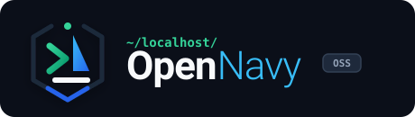

<!-- _class: lead -->

# OPENNAVY
### El Navegador Soberano de Flota para Repositorios Open Source

MLH Hacktoberfest 2026
Google DeepMind Gemma 4
MIT License

**Equipo:** Daniel Echeverría · Brandon Carranza · Dylan Gamero

---

# 1. El Problema: El Muro de Privacidad y la Niebla de Código

  

    <h3 style="color: #F87171; margin-top:0;">🛑 El Muro de Compliance</h3>
    
En banca, salud y defensa, <b>Cursor o Copilot están prohibidos</b> por enviar código a nubes de terceros (SOC2, GDPR).

  

  

    <h3 style="color: #FB923C; margin-top:0;">🌊 Fatiga en Open Source</h3>
    
El <b>80% de contribuidores abandonan</b> al no poder descifrar arquitecturas de 50.000+ líneas.

  

  

    💡 <b>La Solución OpenNavy:</b> Una cabina de mando local-first impulsada por <b>Google Gemma 4</b> y un radar multijugador LAN sin nube.
  

---

# 2. La Trilogía Tecnológica: Demostración en Vivo

  

    <h3 style="color: #38BDF8; margin-top:0;">🧭 Trazador de Rumbo Multimodal</h3>
    
Ingesta de capturas de error o issues. <b>Gemma 4 Vision</b> razona en local (<code>&lt;|think|&gt;</code>) y emite <b>waypoints exactos</b> con Tree-sitter.

  

  

    <h3 style="color: #4ADE80; margin-top:0;">🛰️ Sonar de Flota (Malla LAN)</h3>
    
WebSockets en FastAPI sobre Wi-Fi local. Detecta <b>colisiones arquitectónicas</b> con el <b>Algoritmo de Tarjan SCC</b> antes de hacer git commit.

  

  ⚡ <i>0 ms de latencia a la nube · 100% Soberano · Sin cuentas requeridas</i>

---

# 3. Arquitectura Robusta y Modelo de Negocio

  

    <h3 style="color: #38BDF8; margin-top:0;">⚙️ Arquitectura Hexagonal</h3>
    <ul>
      <li>Tree-sitter AST universal</li>
      <li>Tarjan SCC (O(|V|+|E|) ciclos)</li>
      <li>Google Gemma 4 (<code>e4b</code> / <code>e2b</code>)</li>
      <li>FastAPI + React 18 / Tailwind</li>
    </ul>
  

  

    <h3 style="color: #FACC15; margin-top:0;">💼 Estrategia Open-Core</h3>
    <ul>
      <li><b>Comunidad (MIT):</b> $0, 100% libre para Hacktoberfest y devs.</li>
      <li><b>Flota Enterprise:</b> $35 / dev / mes. On-premise para sectores regulados con auditoría ISO 5055.</li>
    </ul>
  

  
    OpenNavy: La brújula y el radar soberano para el software moderno.
  

